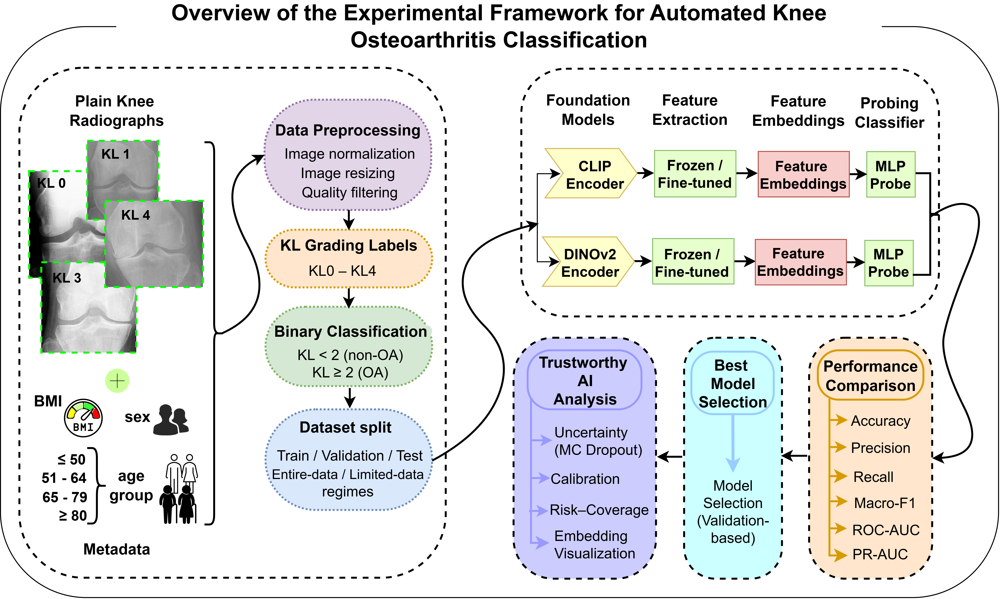

# Data-Efficient and Trustworthy Adaptation of Vision Foundation Models for Knee Osteoarthritis Classification from Plain Radiographs

## Table of Contents

- [Abstract](#abstract)
- [Highlights](#highlights)
- [Repository Structure](#repository-structure)
- [Pipeline](#pipeline)
- [Dataset](#dataset)
- [Publications](#publications)
- [Acknowledgments](#acknowledgments)
- [Citation](#citation)

### Abstract

This repository contains the implementation accompanying our study on the data-efficient and trustworthy adaptation of vision and vision–language foundation models for knee osteoarthritis (OA) classification from plain radiographs. Using 8,950 knee radiographs from the Osteoarthritis Initiative (OAI), we systematically evaluate four pretrained models: CLIP, DINOv2, Qwen3-VL, and MedSigLIP.

The experiments investigate three dimensions: (1) adaptation strategy (frozen visual representations versus end-to-end visual fine-tuning), (2) training-data regime (20%, 50%, and 100% of the training data), and (3) input modality (radiographs alone versus radiographs combined with clinical metadata). Model performance is evaluated using accuracy, macro-F1, and ROC-AUC, followed by reliability analyses involving uncertainty estimation, calibration, risk–coverage assessment, and representation visualization.

With full supervision and metadata, Qwen3-VL achieved the highest macro-F1 (0.8626), while MedSigLIP achieved the highest ROC-AUC (0.9367). The results highlight model-dependent differences in adaptation, data efficiency, and the contribution of clinical metadata.

### Highlights

- Evaluation of CLIP, DINOv2, Qwen3-VL, and MedSigLIP foundation models.
- Frozen feature extraction and end-to-end visual fine-tuning strategies.
- Image-only and metadata-augmented classification.
- Training-data regimes of 20%, 50%, and 100%.
- Patient-level training, validation, and test splits.
- Trustworthy AI evaluation with uncertainty and calibration analysis.
- Risk–coverage assessment and embedding visualization.
- Reproducible experimental pipeline.

### Repository Structure

This repository is organized into modular directories to facilitate reproducibility, readability, and future extension.

<strong>Code:</strong> This directory contains Python scripts and configuration files used for data preprocessing, model training, evaluation, and trustworthy AI analyses across CLIP, DINOv2, Qwen3-VL, and MedSigLIP.

<strong>Dataset:</strong> This directory contains dataset descriptions, clinical metadata, preprocessing information, and data split files associated with the Osteoarthritis Initiative (OAI) dataset. Raw radiographs are not included due to data-sharing restrictions.

<strong>Figures:</strong> This directory contains the figures and visualizations generated for the study, including the proposed pipeline, performance plots, uncertainty analyses, calibration diagrams, risk–coverage curves, and embedding visualizations.

<strong>Models:</strong> This directory includes trained model checkpoints and configuration files for the CLIP- and DINOv2-based experiments.

### Pipeline

The proposed computational framework provides a reproducible pipeline for automated knee osteoarthritis (OA) classification from plain radiographs using pretrained vision and vision–language foundation models. The workflow begins with cohort definition and data preparation, followed by region-of-interest (ROI) extraction and standardized image preprocessing to generate consistent model inputs. Binary knee OA classification (KL &lt; 2 versus KL ≥ 2) is performed using four pretrained foundation models: CLIP, DINOv2, Qwen3-VL, and MedSigLIP. The models are evaluated under frozen feature extraction and end-to-end visual fine-tuning strategies. In addition to image-only learning, the framework supports metadata-augmented classification by integrating radiographic images with age group, sex, and body mass index (BMI).

To evaluate data efficiency, experiments are conducted using 20%, 50%, and 100% of the training data, with fixed patient-level validation and test sets. Model checkpoints are selected using validation macro-F1 and subsequently evaluated on the held-out test set using accuracy, macro-F1, and ROC-AUC. Additional trustworthiness analyses are performed on the selected full-data, fine-tuned, image-only MedSigLIP configuration, including predictive uncertainty estimation using Monte Carlo dropout, calibration analysis, risk–coverage assessment, bootstrap confidence interval estimation, and feature embedding visualization.

### Dataset

This study utilizes plain knee radiographs obtained from the Osteoarthritis Initiative (OAI) database.

### Publications

- **Data-Efficient and Trustworthy Adaptation of Vision and Vision–Language Foundation Models for Knee Osteoarthritis Classification from Plain Radiographs**  
  *Manuscript prepared for [IEEE ISBI 2027](https://biomedicalimaging.org/2027/).*

### Acknowledgments

The authors acknowledge the <a href="https://nda.nih.gov/oai/">Osteoarthritis Initiative (OAI)</a> for providing the imaging and clinical data used in this study.

### Citation

If you use this repository, please cite the following manuscript:

Rezvani, F., Han, Y., Jiang, J., Sarkheyli-Hägele, A., Abiri, N., Myers, N., Liu, H., Visweswaran, S., Wang, Y., Irrgang, J., Urish, K. L., Musahl, V., Plate, J. F., and Tafti, A. P. "Data-Efficient and Trustworthy Adaptation of Vision and Vision–Language Foundation Models for Knee Osteoarthritis Classification from Plain Radiographs." Manuscript prepared for IEEE ISBI 2027.

   
  <b>Pitt Health + Explainable AI (Pitt HexAI) Research Laboratory</b>

