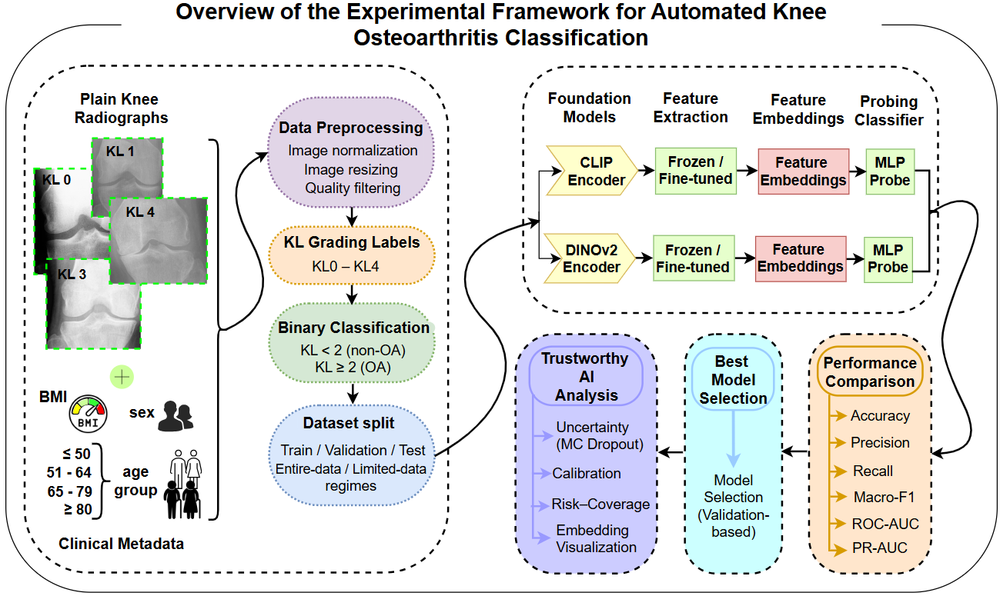

# Data-Efficient and Trustworthy Adaptation of Vision Foundation Models for Knee Osteoarthritis Classification from Plain Radiographs

## Table of Contents

- [Abstract](#abstract)
- [Highlights](#highlights)
- [Repository Structure](#repository-structure)
- [Pipeline](#pipeline)
- [Dataset](#dataset)
- [Publications](#publications)
- [Acknowledgments](#acknowledgments)
- [Citation](#citation)

### Abstract

This GitHub repository contains the complete implementation accompanying our study on data-efficient and trustworthy adaptation of pretrained Vision Foundation Models (VFMs) for automated knee osteoarthritis (OA) classification from plain radiographs.

The repository provides a fully reproducible experimental framework for evaluating the transferability of pretrained foundation models to musculoskeletal imaging under different adaptation strategies, supervision regimes, and input modalities. Specifically, we investigate CLIP and DINOv2 as pretrained image encoders, comparing frozen feature extraction and end-to-end fine-tuning using both radiograph-only and multimodal (radiograph + clinical metadata) learning.

Beyond conventional classification performance, this repository includes comprehensive trustworthy AI analyses, including predictive uncertainty estimation, calibration assessment, risk-coverage analysis, bootstrap confidence intervals, and feature embedding visualization to facilitate reliable and clinically meaningful AI-assisted knee OA assessment.

### Highlights

- Evaluation of CLIP and DINOv2 Vision Foundation Models.
- Frozen Feature Extraction strategy.
- End-to-End Fine-Tuning strategy.
- Image-only and Multimodal Learning strategies.
- Entire-data and Limited-data experimental settings.
- Trustworthy AI evaluation with uncertainty and calibration analysis.
- Risk-coverage assessment and embedding visualization.
- Fully reproducible experimental pipeline.

### Repository Structure

This repository is organized into modular directories to facilitate reproducibility, readability, and future extension.

<strong>Code:</strong> This directory contains all Python scripts and configuration files used for data preprocessing, model training, evaluation, and trustworthy AI analyses.

<strong>Dataset:</strong> This directory contains dataset descriptions, clinical metadata, preprocessing information, and data split files associated with the Osteoarthritis Initiative (OAI) dataset. Raw radiographs are not included due to data-sharing restrictions.

<strong>Figures:</strong> This directory contains the figures and visualizations generated for the study, including the proposed pipeline, performance plots, uncertainty analyses, calibration diagrams, risk-coverage curves, and embedding visualizations.

<strong>Models:</strong> This directory includes trained model checkpoints and configuration files for the CLIP- and DINOv2-based experiments.

### Pipeline

The proposed computational framework provides a comprehensive and reproducible pipeline for automated knee osteoarthritis (OA) classification from plain radiographs using pretrained Vision Foundation Models (VFMs). The workflow begins with cohort definition and data preparation, followed by region-of-interest (ROI) extraction and standardized image preprocessing to generate consistent model inputs. Binary knee OA classification (KL < 2 versus KL ≥ 2) is then performed using two state-of-the-art pretrained foundation models, CLIP and DINOv2, under both frozen feature extraction and end-to-end fine-tuning strategies. In addition to image-only learning, the framework supports multimodal learning by integrating radiographic images with structured clinical metadata to investigate the complementary value of clinical information for disease classification.

To systematically evaluate model generalizability under realistic clinical scenarios, experiments are conducted using both entire-data and limited-data training settings with validation-based model selection. Beyond conventional classification performance, the proposed framework incorporates a comprehensive trustworthy AI evaluation pipeline, including predictive uncertainty estimation, calibration analysis, risk-coverage assessment, bootstrap confidence intervals, and feature embedding visualization. Together, these components provide a transparent, reliable, and fully reproducible framework for investigating the adaptation of Vision Foundation Models to musculoskeletal imaging applications.

### Dataset

This study utilizes plain knee radiographs obtained from the Osteoarthritis Initiative (OAI) database.

### Publications

### Acknowledgments

### Citation

   
  <b>Pitt Health + Explainable AI (Pitt HexAI) Research Laboratory</b>

